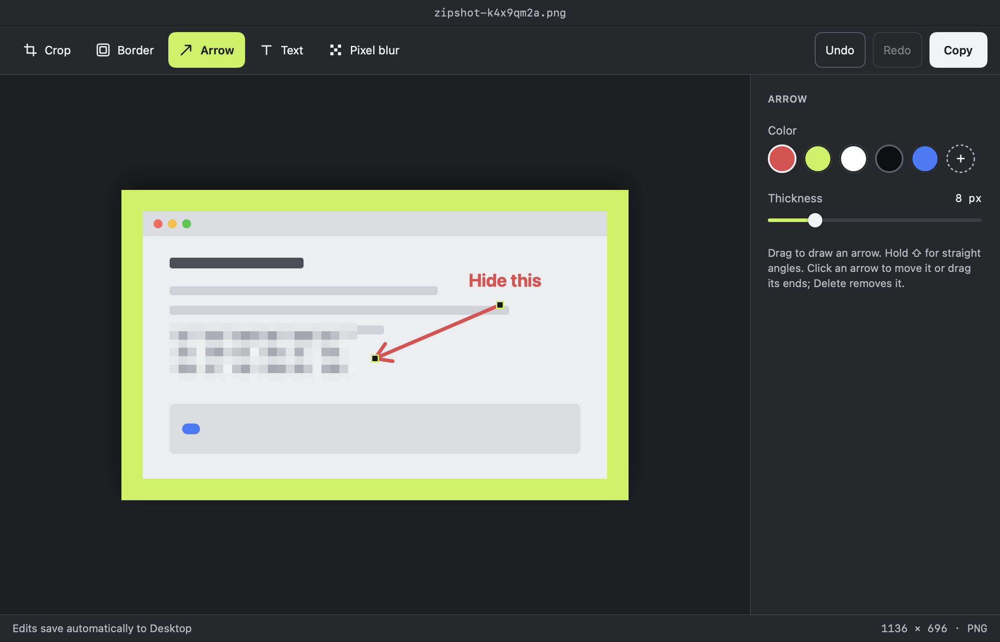
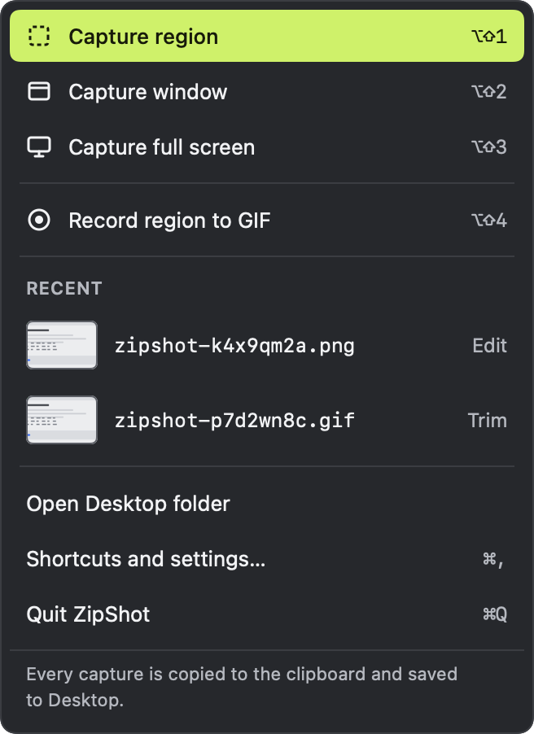
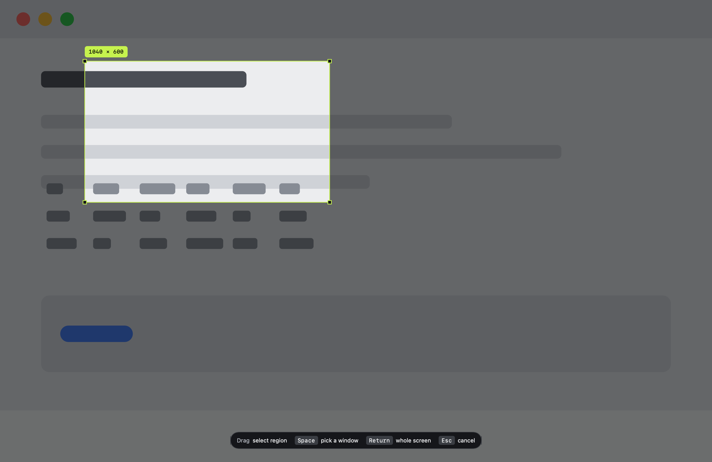
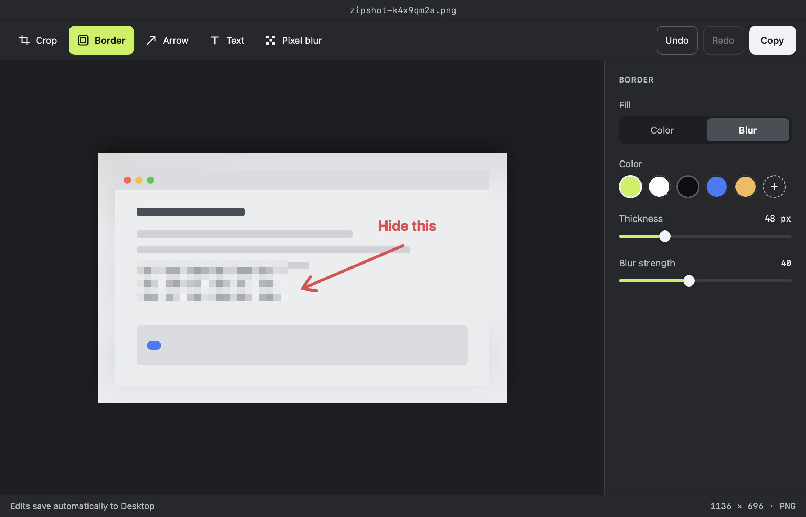
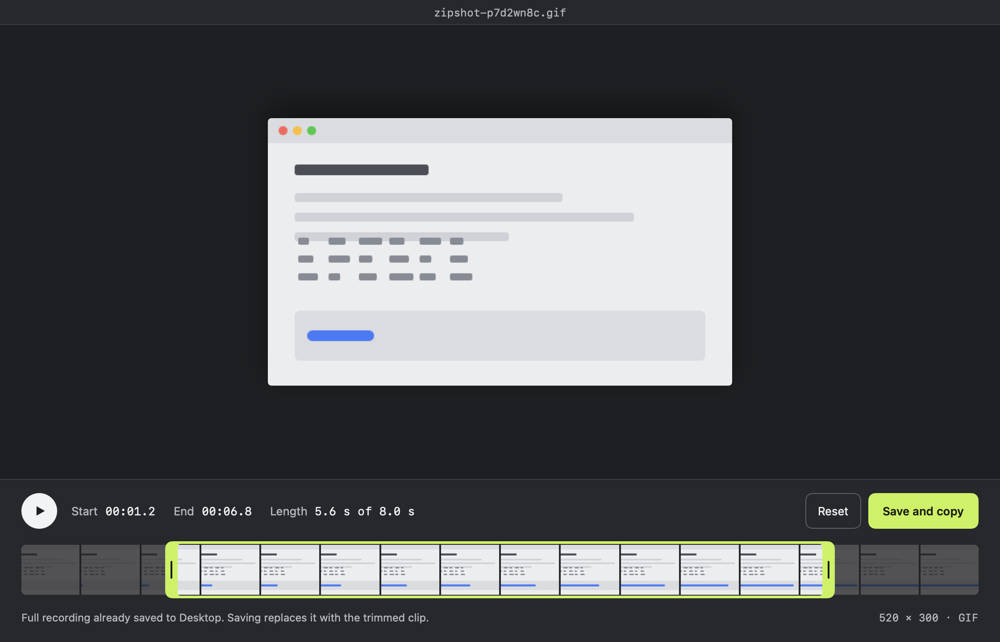

# ZipShot

A macOS menu bar app for screenshots and GIF recordings, with a built-in
editor. Written in Swift.

Every capture is copied to the clipboard and saved to the Desktop as
`zipshot-<random>.png` or `zipshot-<random>.gif`.



## Install

1. Download `ZipShot-<version>.zip` from the
   [latest release](https://github.com/ziptie-app/zipshot/releases/latest)
   and unzip it.
2. Drag **ZipShot** into your Applications folder and open it.
3. macOS will say it could not verify the app, because release builds are not
   notarized by Apple. Open **System Settings › Privacy & Security**, scroll to
   **Security**, and click **Open Anyway** next to ZipShot. (On macOS 14,
   right-click the app and choose **Open** instead.)
4. Take a capture. The first one makes macOS ask for permission to record the
   screen: turn ZipShot on under **System Settings › Privacy & Security ›
   Screen & System Audio Recording**, then let macOS quit and reopen it.

Needs macOS 14 or later. Runs on Apple silicon and Intel.

## Capturing



| | Shortcut | |
|---|---|---|
| Capture region | ⌥⇧1 | Drag to select. Space switches to picking a window, Return takes the whole screen, Esc cancels. |
| Capture window | ⌥⇧2 | Click a window. Captured on its own, with transparent corners and no shadow. |
| Capture full screen | ⌥⇧3 | The screen the pointer is on. |
| Record region to GIF | ⌥⇧4 | Drag to select, then Start / Pause / Stop. The shortcut also starts and stops. |

Everything is also in the menu bar icon's menu, along with the most recent
captures. Shortcuts can be changed under **Shortcuts and settings…**.

<br clear="right">



## Editing

After a screenshot, a notice appears in the corner with **Edit**; recent
captures are also listed in the menu. The editor has five tools:

- **Crop** – drag the frame or its handles; drag outside it to start over.
- **Border** – a frame around the capture, filled with a color or with a
  blurred copy of the capture itself, at any thickness.
- **Arrow** – drag to draw; hold ⇧ for straight angles.
- **Text** – click to type; double-click existing text to change it.
- **Pixel blur** – drag over anything to hide it, pixelated or smooth.



Arrows, text and blurs stay editable: click one to move it, drag its handles,
change its color or size, or press Delete. Undo and redo cover everything.
Edits are saved back to the file on the Desktop as you make them; **Copy**
(⌘C) puts the edited image on the clipboard.

## Trimming a recording



Stopping a recording saves the full GIF, then opens the trim editor: drag the
two handles to set where the clip starts and ends, press Space to preview, and
**Save and copy** to replace the file with the trimmed clip. The original
frames are kept while the recording is among the recent captures in the menu
(and never past quitting), so a trim can be redone.

## If the menu bar icon is missing

On a full menu bar macOS puts new icons behind the notch, where they cannot be
seen. ZipShot notices this at launch and takes a slot near the right end
instead (another icon gives way); ⌘-drag it wherever you prefer afterwards.

Menu bar organizers (Bartender, Ice, Hidden Bar…) can also hide new icons;
ZipShot leaves those alone. The shortcuts work regardless, and opening ZipShot
again while it is running shows its settings window.

## Building from source

Requires macOS 14 or later and a Swift 5.9+ toolchain. Xcode is not needed;
the Command Line Tools are enough.

```sh
Scripts/build-app.sh            # builds build/ZipShot.app
Scripts/build-app.sh --run      # builds, then launches it
Scripts/build-app.sh --install  # builds, copies to /Applications, launches that
```

The build is ad-hoc signed by default. macOS ties the screen recording
permission to the signature, and an ad-hoc signature changes with every build,
so each rebuild asks again (`tccutil reset ScreenCapture dev.zipshot.ZipShot`
clears stale entries). To keep the permission across rebuilds, create a
self-signed *Code Signing* certificate in Keychain Access and build with it:

```sh
ZIPSHOT_SIGN_IDENTITY="My Certificate Name" Scripts/build-app.sh --install
```

### Releasing

Pushing a tag publishes a release: the
[Release workflow](.github/workflows/release.yml) runs the core checks, builds
a universal `ZipShot.app` stamped with the tag's version, and attaches
`ZipShot-<version>.zip` and its SHA-256 to a new GitHub release.

```sh
git tag -a v1.1 -m "ZipShot 1.1"
git push origin v1.1
```

Running the workflow by hand from the Actions tab builds the same zip as a
workflow artifact without releasing anything.

### Layout

```
Sources/ZipShotCore   Logic with no UI state: the edit model, rendering,
                      the GIF encoder, on-disk frame storage, file naming.
Sources/ZipShot       The app.
  App/                Startup, menu bar dropdown, shortcuts, settings.
  Capture/            ScreenCaptureKit calls, the selection overlay, capture flows.
  Editor/             The capture editor: model, canvas, window.
  Recording/          Region recorder, recording controls, trim editor.
  Output/             Saving, clipboard, recent captures, the after-capture notice.
  Support/            Theme, icons, shared controls, developer checks.
Sources/SelfTest      Headless checks for ZipShotCore.
Scripts/              App bundle build and icon drawing.
Resources/            Info.plist.
```

A few things worth knowing before changing the code:

- **Edits never touch the captured pixels.** An `EditState` (annotations, crop,
  border) is rendered over the original each time, which is what makes
  everything undoable and re-editable. All geometry is in image pixels with a
  top-left origin; tool sizes are kept in points and multiplied by the
  capture's display scale.
- **Screenshots are taken before the overlay appears.** Each display is frozen
  first and the selection is cropped from that still, so the result is what
  was on screen when the shortcut was pressed, menus and hover states included.
- **GIFs are written by ZipShot's own encoder** (`GIFEncoder.swift`). It stores
  only the rectangle that changed in each frame, drops frames that did not
  change, and streams to disk, which keeps screen recordings small and memory
  flat. Recorded frames are held losslessly in a temporary file
  (`FrameStore`), not in memory.
- **ZipShot's own floating windows are excluded from captures** through
  `CaptureExclusion`. A new always-on-top window should be added to it.

### Checks

```sh
swift run -c release zipshot-selftest      # core: GIF round trips, trimming, rendering
.build/release/ZipShot --ui-check          # editors and overlay, driven by synthetic input
.build/release/ZipShot --ui-snapshots DIR  # draws every piece of UI to PNGs in DIR
.build/release/ZipShot --capture-check DIR # real captures; needs screen recording allowed
```

The self-test is a plain executable rather than an XCTest target so that it
runs with only the Command Line Tools installed. The three `ZipShot` flags run
off screen with sample content and a scratch settings store; they do not write
to the Desktop or the clipboard. `--capture-check` does nothing unless the
terminal it is run from already has screen recording permission. The
screenshots in this README are `--ui-snapshots` output.
